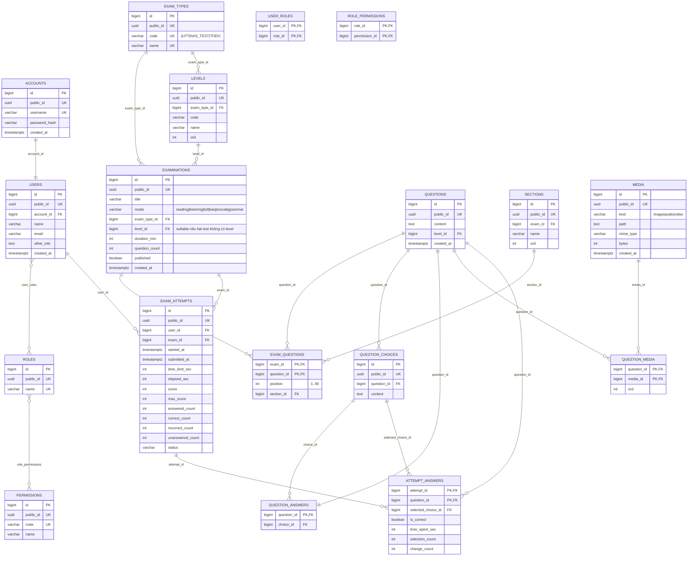

# Cấu trúc DB



## Cấu trúc lưu trữ MinIO

Media local được lưu trong bucket `jlpt-media`; `media.path` trong SQL là public
path tương ứng với object key trong MinIO:

```text
Bucket: jlpt-media
└── exams/
    └── {exam_id}/
        └── media/
            └── {filename}
```

Ví dụ:

```text
Bucket: jlpt-media
Object: exams/de-1/media/m-3c0c33d196ac.mp3
Public path: /exams/de-1/media/m-3c0c33d196ac.mp3
```

Metadata object và nguồn file local nằm trong
MinIO là nơi lưu object media. Media URL ngoài không
upload vào MinIO; `media.path` giữ nguyên URL nguồn.

## Mẫu dữ liệu

`EXAM_TYPES` là nhóm bài test, ví dụ `JLPT`, `NAS_TEST`, `TOEIC`. Mỗi nhóm có thể
có bộ `LEVELS` riêng; ví dụ JLPT có `N5`, `N4`, `N3`, `N2`, `N1`. Với bài test
không có level, `level_id` được để `null`.

Khi tạo `EXAMINATIONS`, `level_id` phải thuộc cùng `exam_type_id`; ví dụ không
được gắn level `N5` của JLPT cho một đề có `exam_type_id` là TOEIC.

Mẫu danh mục loại bài test và level:

```json
{
  "exam_types": [
    {
      "id": 1,
      "public_id": "01932f10-21aa-7b01-8c22-3d4e5f6a7b88",
      "code": "JLPT",
      "name": "Japanese-Language Proficiency Test"
    },
    {
      "id": 2,
      "public_id": "01932f18-31bb-7c02-9d33-4e5f6a7b8c99",
      "code": "TOEIC",
      "name": "Test of English for International Communication"
    }
  ],
  "levels": [
    {
      "id": 11,
      "public_id": "01932f20-41cc-7d03-ae44-5f6a7b8c9d00",
      "exam_type_id": 1,
      "code": "N5",
      "name": "JLPT N5",
      "ord": 1
    },
    {
      "id": 12,
      "public_id": "01932f28-51dd-7e04-bf55-6a7b8c9d0011",
      "exam_type_id": 1,
      "code": "N4",
      "name": "JLPT N4",
      "ord": 2
    }
  ]
}
```

```json
{
  "examinations": {
    "id": 101,
    "public_id": "01932f7e-3c1a-7b21-9f4a-2c8e6d0b1a55",
    "title": "Đề Thi JLPT N5 – Đề 1 10/2024",
    "mode": "full",
    "exam_type_id": 1,
    "level_id": 11,
    "duration_min": 90,
    "question_count": 90,
    "published": true
  },
  "questions": {
    "id": 1001,
    "public_id": "01932f91-8a44-7c10-8d32-6f0b5e2a4c77",
    "content": "新（あたら）しい カメラですね。",
    "level_id": 11
  },
  "question_choices": [
    {
      "id": 4001,
      "public_id": "01932fa8-1d23-7a91-b4c8-0e6f2d5a9b33",
      "question_id": 1001,
      "content": "あらたしい"
    },
    {
      "id": 4003,
      "public_id": "01932fb0-6e52-7a04-a7c1-9d3f5b8e2c66",
      "question_id": 1001,
      "content": "あたらしい"
    }
  ],
  "question_answers": [
    {
      "question_id": 1001,
      "choice_id": 4003
    }
  ],
  "exam_questions": {
    "exam_id": 101,
    "question_id": 1001,
    "section_id": 11,
    "position": 1
  },
  "exam_attempts": {
    "id": 9001,
    "public_id": "0193302c-4b11-7f32-9c64-1a8e5d0b3f20",
    "user_id": null,
    "exam_id": 101,
    "status": "submitted",
    "started_at": "2026-11-09T10:00:00Z",
    "submitted_at": "2026-11-09T10:42:35Z",
    "time_limit_sec": 5400,
    "elapsed_sec": 2555,
    "score": 72,
    "max_score": 90,
    "answered_count": 80,
    "correct_count": 72,
    "incorrect_count": 8,
    "unanswered_count": 10
  },
  "attempt_answers": [
    {
      "attempt_id": 9001,
      "question_id": 1002,
      "selected_choice_id": 4010,
      "is_correct": false,
      "time_spent_sec": 60,
      "selection_count": 3,
      "change_count": 2
    }
  ]
}
```

`public_id` là giá trị dùng cho API/URL; các cột `*_id` trong DB vẫn tham chiếu
`BIGINT id` nội bộ để join nhanh. `user_id = null` minh họa attempt ẩn danh theo
phạm vi hiện tại.

### Mẫu JSON nguồn đề tổng hợp (`data/exams/de-1.json`)

```json
{
  "id": "1",
  "title": "Đề Thi JLPT N5 – Đề 1 10/2024",
  "mode": "full",
  "questionCount": 90,
  "durationMinutes": 90,
  "answerKey": {
    "1": "C",
    "2": "D"
  },
  "questions": [
    {
      "id": 1,
      "label": "Câu 1",
      "kind": "Nhận biết",
      "quizHtml": "<p>1. 新（あたら）しい カメラですね。</p>",
      "choices": [
        { "key": "A", "html": "1. あらたしい" },
        { "key": "B", "html": "2. あらだしい" },
        { "key": "C", "html": "3. あたらしい" },
        { "key": "D", "html": "4. あだらしい" }
      ]
    }
  ]
}
```

Response summary tương ứng từ `GET /api/v1/exams`:

```json
{
  "id": "de-1",
  "title": "Đề Thi JLPT N5 – Đề 1 10/2024",
  "questionCount": 90,
  "durationMinutes": 90,
  "kind": "mock",
  "subject": null,
  "subjectLabel": null
}
```

### Mẫu JSON nguồn đề theo môn (`data/exams/jt4y-n5-grammar-14.json`)

```json
{
  "id": "jt4y-n5-grammar-14",
  "title": "JLPT N5 – Grammar Exercise 14",
  "mode": "grammar",
  "questionCount": 10,
  "durationMinutes": 15,
  "answerKey": {
    "1": "B"
  },
  "questions": [
    {
      "id": 1,
      "label": "Câu 1",
      "kind": "Ngữ pháp",
      "quizHtml": "おとうとはいしゃ _______ なりました。",
      "choices": [
        { "key": "A", "html": "を" },
        { "key": "B", "html": "に" },
        { "key": "C", "html": "で" },
        { "key": "D", "html": "の" }
      ]
    }
  ]
}
```

Response summary tương ứng:

```json
{
  "id": "jt4y-n5-grammar-14",
  "title": "JLPT N5 – Grammar Exercise 14",
  "questionCount": 10,
  "durationMinutes": 15,
  "kind": "review",
  "subject": "grammar",
  "subjectLabel": "Ngữ pháp"
}
```

### Mẫu tạo và nộp attempt

Tạo attempt:

```json
{
  "examId": "de-1",
  "durationMinutes": 90
}
```

Nộp attempt:

```json
{
  "answers": [
    {
      "questionId": 1,
      "choiceKey": "C"
    },
    {
      "questionId": 2,
      "choiceKey": null
    }
  ]
}
```

Response attempt hiện tại:

```json
{
  "id": "a1b2c3d4e5f6",
  "examId": "de-1",
  "status": "submitted",
  "score": null,
  "maxScore": null,
  "startedAt": "2026-11-09T10:00:00+00:00",
  "submittedAt": "2026-11-09T10:25:00+00:00"
}
```

`selection_count` tính cả lần chọn đầu tiên; `change_count` chỉ tính số lần đổi
sang lựa chọn khác. `is_correct` có thể `null` khi attempt chưa nộp và được backend
tính sau khi nộp.

`score` và `maxScore` hiện có trong schema nhưng chưa được `AttemptService` tính
trong skeleton. Khi triển khai chấm điểm thật, câu trả lời phải tham chiếu bằng
`question_id` và `selected_choice_id`, không phụ thuộc vị trí của câu hỏi trong frontend.
